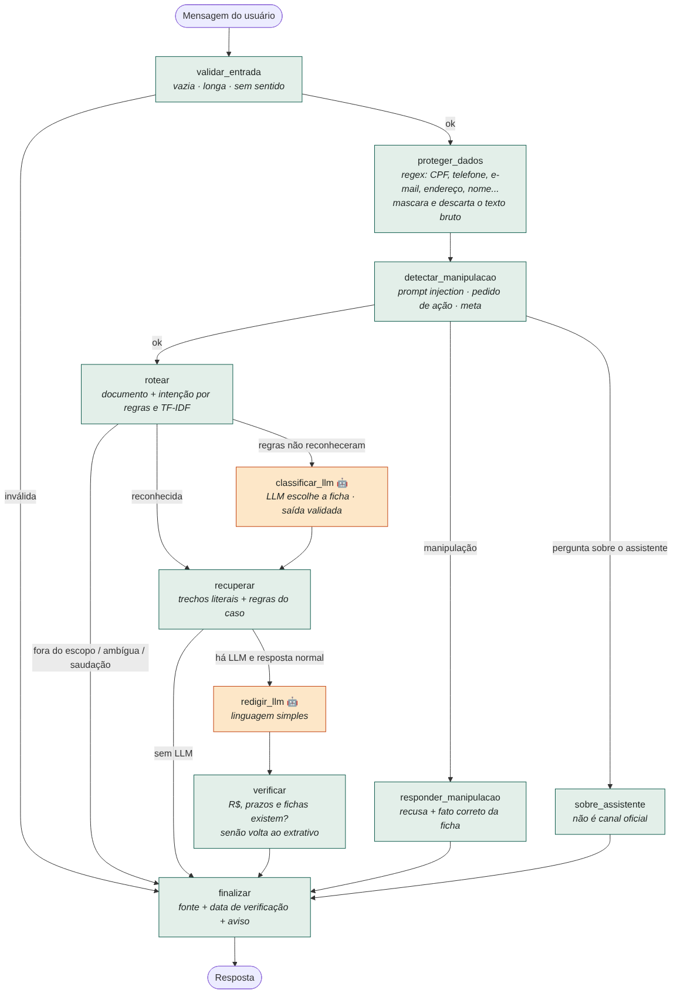

# Citizen Assist AI: Assistente Digital de Orientação ao Cidadão

**Integrantes**
- Nickollas Korner · RM 569655
- João Pedro Ferrari · RM 573037
- Vitor Nascimento · RM 571873

Agente em **LangGraph** que responde dúvidas sobre RG, CPF, título de eleitor, carteira de trabalho, certidões e CNH usando **somente** as 7 fichas da Central do Cidadão de Aurora (central fictícia, para fins didáticos). Toda resposta cita a ficha e a data de verificação e avisa que o assistente não é um canal oficial.

📄 Relatório com justificativas e resultados: [`docs/relatorio.md`](docs/relatorio.md) · 📓 Notebook executado: [`Citizen_Assist_AI.ipynb`](Citizen_Assist_AI.ipynb)



## Como rodar

```bash
pip install -r requirements.txt

# escolha o modelo (opcional: sem isso, o agente roda no modo extrativo, sem rede)
export GROQ_API_KEY=...              # Groq (padrão)
# ou: export CITIZEN_LLM=ollama      # Ollama local (ollama pull llama3.1:8b)

python app_web.py                    # chat no navegador: http://localhost:8000
python app_cli.py                    # chat no terminal, com menu numerado
```

## Avaliação (golden dataset + LLM as a Judge)

```bash
python avaliacao/rodar_avaliacao.py --versao v1   # antes  (versão congelada em citizen_assist_v1/)
python avaliacao/rodar_avaliacao.py --versao v2   # depois
python avaliacao/rodar_avaliacao.py --comparar    # tabela antes × depois
python -m pytest -q                               # 129 testes automatizados (rodam sem internet)
```

O juiz é o LLM quando há provedor configurado; sem provedor, usa a régua determinística (`--juiz regras`). Os resultados vão para `avaliacao/resultados/`.

## Testes com usuários

Siga `testes_usuarios/protocolo.md`, preencha os dois CSVs só com códigos anônimos (P1, P2...) e rode:

```bash
python testes_usuarios/calcular_indicadores.py
```

## Estrutura

```
base_conhecimento/          as 7 fichas (única fonte de verdade)
citizen_assist/             agente atual (v2)
  agente.py                 grafo LangGraph: nós e arestas
  base.py · busca.py        leitura das fichas · documento, intenção e TF-IDF
  regras.py                 regras do caso (idade, vencimento, prazo eleitoral...)
  protecao.py               validação, dados pessoais, injection, pedidos de ação
  recuperacao.py            composição da resposta com fonte e data
  modelos.py                LLM via LangChain (Groq/Ollama) e prompts
  verificacao.py            checa se o texto do LLM só usa fatos das fichas
  menu.py · config.py       menu por categorias · modelo, provedor, aviso
  _minigrafo.py             substituto do LangGraph só para ambientes sem internet
citizen_assist_v1/          versão 1 congelada (antes da melhoria)
avaliacao/                  golden dataset, juiz, execução, resultados, perguntas próprias
testes_usuarios/            protocolo, planilhas modelo, cálculo dos indicadores
tests/                      pytest
web/index.html              interface acessível
docs/                       relatório, diagrama da arquitetura
```

## Privacidade

O sistema não pede, não guarda e não envia dados pessoais: as mensagens são mascaradas antes de qualquer processamento, não há log de perguntas e a conversa só lembra o código da ficha anterior. Os testes usam apenas dados fictícios.
